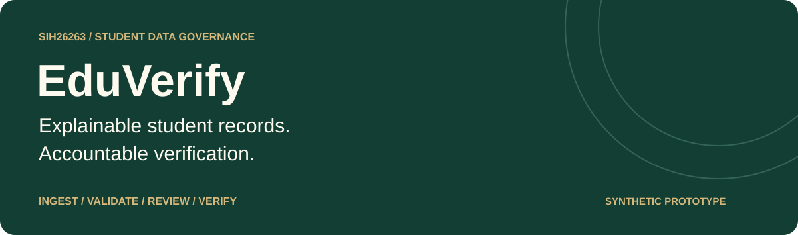
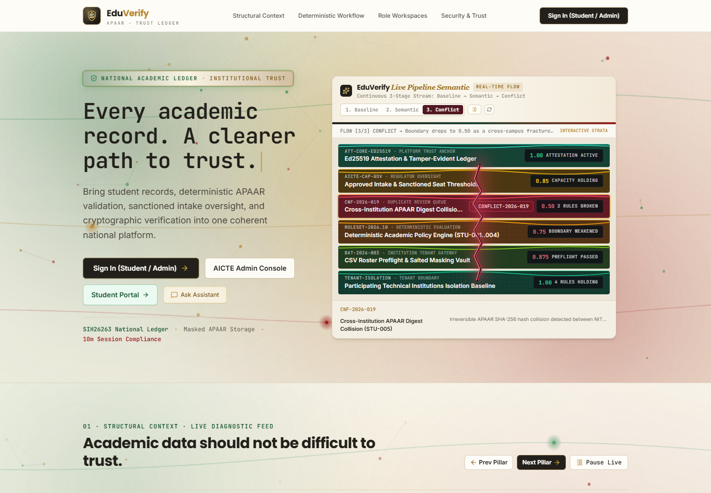
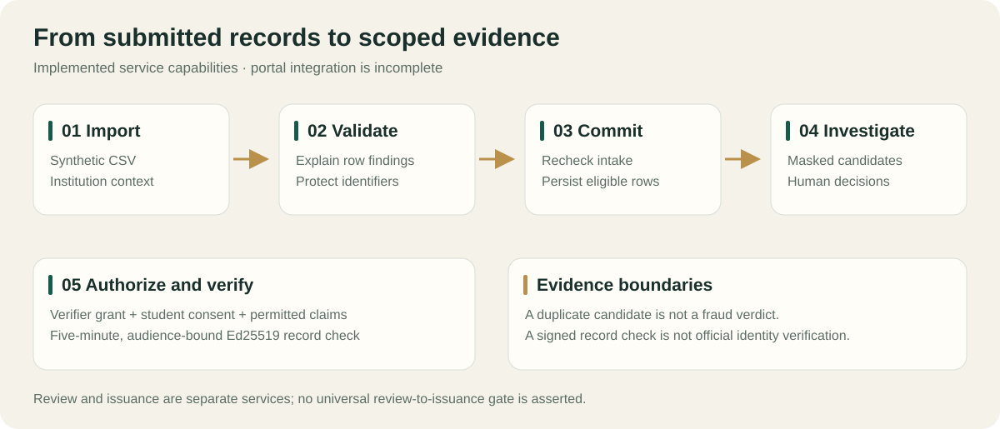
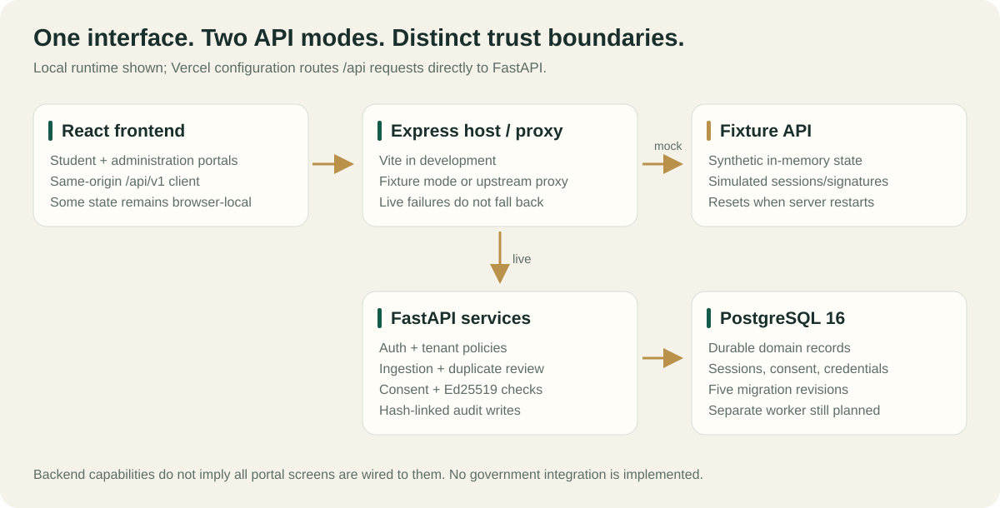

<p align="center">
  
</p>

<p align="center">
  <a href="https://eduverify-eight.vercel.app/">Explore the website</a> ·
  <a href="#quick-start">Run locally</a> ·
  <a href="docs/FEATURES-AND-USP.md">Feature & USP analysis</a> ·
  <a href="docs/downloads/EduVerify-Features-and-USP.pdf">Download the PDF</a>
</p>

<p align="center">
  
  
  
  
  <a href="LICENSE"></a>
</p>

## Overview

**EduVerify connects student record ingestion, explainable validation, duplicate investigation, intake monitoring and consent-scoped record checks.** Built around **SIH26263**, it explores how institutions, students and regulators can work from accountable enrolment data.

The application is branded **EduVerify**. Internal modules, package names and earlier design documents retain **WEAVE**; they refer to this same project.

> [!IMPORTANT]
> This is a **synthetic-data prototype with a partially integrated persistent backend**. FastAPI implements real authentication and Ed25519 record-check signing, while the Express demo uses simulated sessions and signatures. Several portal actions still use browser-local fixtures. No official APAAR, DigiLocker or AICTE connectivity is implemented. Use synthetic records only.

## Product preview



*Actual public website capture, 30 October 2026. Public page availability does not establish authenticated workflow readiness.*

## Why EduVerify

| Product focus | Implemented foundation | Value to the user |
| --- | --- | --- |
| Explainable validation | Structured CSV parsing and deterministic row findings | Operators can identify what needs correction. |
| Privacy-aware duplicate review | Keyed identity references, name similarity within DOB blocks, masked cases | Reviewers investigate overlaps without exposing full identifiers in case responses. |
| Capacity checks at commit | Programme/year and category-pool checks under database locks | Imports are rechecked against available intake before enrolments are written. |
| Consent-scoped evidence | Verifier grants, student consent, five-minute audience-bound Ed25519 credentials | External verifiers receive permitted record claims. |
| Accountable operations | Server-side role policies, institution scope and hash-linked audit records | Backend decisions can be traced to their context. |
| Student participation | Profile, records, discrepancy and consent interfaces | Demonstrates how students could inspect and correct records; several actions remain local fixtures. |

These are evidence-backed product strengths, not claims of market exclusivity or completed production assurance. See the [detailed analysis](docs/FEATURES-AND-USP.md) for evidence, tradeoffs, gaps and presentation wording.

## Workflow



1. **Import:** submit a synthetic CSV in an institution context.
2. **Validate:** inspect row-level errors, warnings and review findings.
3. **Commit:** persist eligible rows after checking current approved capacity.
4. **Investigate:** scan for duplicate candidates and record a human decision. Matching is an investigation lead, not a fraud verdict.
5. **Authorize and verify:** provision a verifier grant, obtain scoped student consent and request signed record claims through the backend API.

This diagram describes service capabilities. It does not mean every step is connected through the current UI, or that duplicate review automatically blocks every credential issuance.

## Feature status

**Backend** means code exists in FastAPI; **demo** means synthetic or local state; **gap** means additional integration is needed.

| Capability | Current status | Main interface |
| --- | --- | --- |
| Student dashboard, profile and academic records | Demo portal; combines API responses and seeded records | `/student/dashboard`, `/student/profile`, `/student/academic-records` |
| Student APAAR, verification, discrepancies, consent and history | Demo/local actions; not fully connected to backend privacy services | `/student/apaar`, `/student/verification`, `/student/discrepancies`, `/student/consent`, `/student/history` |
| Admin overview and directories | UI present; fixture assumptions remain in adapters | `/admin/dashboard`, `/admin/institutions`, `/admin/students` |
| CSV ingestion, validation and commit | Backend implemented; matching frontend endpoints exist | `/admin/bulk-upload`, `/admin/data-validation`, `/admin/imports/:id` |
| Duplicate scan and human decision | Backend implemented; UI still calls legacy `/conflicts` | `/admin/duplicates`; backend `/api/v1/students/duplicates` |
| Approved intake monitoring | UI present; backend enforces capacity at commit | `/admin/intake-monitoring` |
| Signed record checks and scoped consent | Backend implemented; legacy UI uses a different API | `/api/v1/consents`, `/api/v1/verification/*` |
| Attestation registry and public token page | Express demo; no FastAPI public equivalent | `/admin/verification`, `/verify/:token` |
| Reports and audit timeline | Demo UI; backend writes audit records but lacks legacy timeline endpoint | `/admin/reports`, `/admin/audit-logs` |
| Advisory assistant | Express demo and optional Gemini calls; no FastAPI endpoint | `/admin/assistant` |

Routes are defined in [src/App.tsx](src/App.tsx). Legacy `/app/*` routes mostly redirect to `/admin/*`. The Three.js spatial component exists in source but is not an active topology route.

## Quick start

Use **Node.js 22+**, npm and Git. Python and PostgreSQL are unnecessary for the local fixture demo.

```bash
git clone https://github.com/Sarthaksulkhlan/EduVerify.git
cd EduVerify
npm install
npm run dev
```

Open **http://localhost:3000** and visit `/login`. The form provides synthetic administration/student values. With no live-mode configuration, Express serves the fixture API and Vite serves the frontend. Server state resets on restart; browser-local portal changes reset on reload.

| Command | Purpose |
| --- | --- |
| `npm run dev` | Start Express and Vite together on port 3000 |
| `npm run lint` | TypeScript checking (`tsc --noEmit`) |
| `npm test` | Existing TypeScript engine tests |
| `npm run build` | Build the frontend into `dist/` |
| `npm start` | Serve the build with Express on POSIX shells |

For production-mode serving on Windows PowerShell, build first, then run:

```powershell
$env:NODE_ENV = 'production'
npx tsx server.ts
```

The repository includes `bun.lock`; npm installation creates its own lockfile. Production-mode serving does not make the fixture API production-safe.

### Persistent backend development

Use **Python 3.12+** and **PostgreSQL 16**. From the repository root, in PowerShell:

```powershell
py -3.12 -m venv apps/api/.venv
& apps/api/.venv/Scripts/Activate.ps1
python -m pip install -e "apps/api[dev]"
Copy-Item .env.example .env
```

Before starting services, replace the template password in **both** `POSTGRES_PASSWORD` and `DATABASE_URL`, and set a freshly generated `APAAR_HMAC_KEY`. Keep the demo database named `weave_demo` on loopback. Follow the [API setup guide](apps/api/README.md) for key generation and account provisioning. Preserve an existing configured `.env` instead of copying over it.

```powershell
docker compose --env-file .env -f infra/compose.yaml up -d db
python -m alembic -c apps/api/alembic.ini upgrade head
python -m app.cli seed-demo
python -m app.cli create-user
python -m uvicorn app.main:app --app-dir apps/api --host 127.0.0.1 --port 8000 --reload
```

`seed-demo` creates fictional institutions, programme/year capacity and reproducible CSV scenarios under `synthetic/generated/`. It does **not** create passwords. Provision accounts interactively with the printed institution IDs. FastAPI documentation is available at **http://127.0.0.1:8000/docs**.

To exercise the root server's proxy, set `VITE_API_MODE=live` and `WEAVE_FASTAPI_URL=http://127.0.0.1:8000` in `.env`, then run `npm run dev` in another terminal. Unavailable upstreams return errors rather than fixture API responses.

> [!NOTE]
> Live mode is an integration-development path, not a complete portal walkthrough. FastAPI requires email/password login, but the UI prefills demo IDs; the client also substitutes fixture identities and a synthetic student token. Use the API documentation for backend evaluation until these adapters are reconciled. Backend authorization remains server-enforced.

### Configuration that matters

| Setting | Used for |
| --- | --- |
| `VITE_API_MODE` | Root Express API mode: `mock` by default, or `live` |
| `WEAVE_FASTAPI_URL` / `FASTAPI_URL` | Proxy upstream; a `FASTAPI_URL` service binding also enables live mode |
| `DATABASE_URL`, `POSTGRES_PASSWORD` | FastAPI persistence and local database setup |
| `APAAR_HMAC_KEY`, `APAAR_HMAC_KEY_VERSION`, `APAAR_HMAC_PREVIOUS_KEYS` | Backend identifier linkage and rotation overlap |
| `VERIFICATION_SIGNING_PRIVATE_KEY` | URL-safe base64 DER Ed25519 private key for backend record checks; absent key returns 503 |
| `AUTH_COOKIE_SECURE` | Secure cookie setting; use HTTPS configuration for hosted environments |
| `GEMINI_API_KEY` | Optional Express assistant calls; provide through the process environment |

The client currently calls same-origin `/api/v1` directly; `VITE_API_BASE_URL` is not consumed by that client. The root server loads `VITE_` and `WEAVE_` variables using Vite; FastAPI reads its settings separately. See [.env.example](.env.example) and [backend configuration](apps/api/app/core/config.py) for the full template.

## Architecture



| Layer | Current implementation |
| --- | --- |
| Web application | React 19, TypeScript 5.8, Vite 6, React Router 7 |
| Interface and data | Tailwind CSS 4, TanStack Query, React Hook Form, Zod, Recharts; Three.js visual components |
| Local host / fixture API | Express 4 and `tsx`; same-origin proxy to FastAPI in live mode |
| Persistent API | FastAPI, Pydantic, SQLAlchemy 2, Psycopg, Alembic |
| Database | PostgreSQL 16; five migration revisions in this snapshot |
| Backend trust mechanisms | scrypt passwords, opaque bearer sessions, keyed HMAC linkage, Ed25519 record checks |
| Deployment configuration | Vercel frontend/API services in [vercel.json](vercel.json); local PostgreSQL in [infra/compose.yaml](infra/compose.yaml) |

The accepted design still specifies a separate PostgreSQL-backed worker and an `apps/web` workspace. The runnable frontend currently lives at the root; a separate worker is not implemented. [DECISION.md](DECISION.md) records design intent and should be read alongside the current code.

```text
src/                      React portals, client adapters, demo engine and tests
server.ts                 Express fixture API and FastAPI proxy
apps/api/                 FastAPI routes, services, models, migrations and tests
apps/web/                 Planned frontend workspace (README only)
packages/contracts/       Shared OpenAPI specification
rules/                    Validation rule definitions
infra/                    Local PostgreSQL Compose configuration
synthetic/                Synthetic-data guidance; scenarios generated after seeding
docs/                     Design documents, visuals and feature/USP report
  downloads/              Shareable PDF analysis
```

## Verification and known boundaries

Run checks appropriate to the layer being changed:

```bash
npm run lint
npm test
npm run build
python -m pytest apps/api/tests
python -m ruff check apps/api
python -m ruff format --check apps/api
```

PostgreSQL tests require `WEAVE_TEST_DATABASE_URL` pointing to a **disposable database whose name ends in `_test`**. Their fixture applies migrations and drops/recreates its public schema during cleanup. Without that variable, database-dependent tests skip.

- **Identity:** APAAR format/matching checks do not establish official identity or government verification.
- **Cryptography:** TypeScript attestations simulate signing. FastAPI record checks use real Ed25519, but are a distinct API and credential format.
- **Privacy:** identifiers are masked and keyed for linkage; names and dates of birth are still processed and stored for ingestion. This is not a zero-personal-data architecture.
- **Integration:** student consent/discrepancies and several admin operations remain fixtures or legacy calls. Browser role display is not authorization.
- **Readiness:** capacity, tenant isolation, revocation and concurrent audit behavior need full database and end-to-end evidence before operational use.
- **AI:** the assistant is advisory. Deterministic validation, access control and signature decisions belong in backend code.

The [feature/USP report](docs/FEATURES-AND-USP.md) includes prioritized integration issues, a demonstration script, measurable acceptance criteria and claim boundaries.

## Roadmap

1. Preserve authenticated backend identities and tokens in every frontend flow.
2. Connect duplicate review, consent, credentials and audit screens to actual FastAPI contracts.
3. Reconcile claim allowlists and credential invalidation semantics; expand lifecycle integration tests.
4. Demonstrate tenant isolation, concurrent intake enforcement and audit integrity against PostgreSQL.
5. Add the worker, deployment smoke tests, accessibility checks and operational key management.

## Documentation

| Document | Purpose |
| --- | --- |
| [Feature & USP analysis](docs/FEATURES-AND-USP.md) · [PDF download](docs/downloads/EduVerify-Features-and-USP.pdf) | Capabilities, differentiators, gaps and demonstration plan |
| [API setup](apps/api/README.md) | Backend environment, accounts, endpoints and fixtures |
| [Decision register](DECISION.md) · [Rulebook](RULEBOOK.md) | Architecture intent, ownership and engineering requirements |
| [Original MVP analysis](docs/01-analysis-and-features.md) | Problem framing and initial scope |
| [Architecture](docs/02-system-architecture.md) · [Database](docs/03-database-schema.md) | Target system design |
| [API design](docs/04-api-spec.md) · [OpenAPI contract](packages/contracts/openapi.yaml) | Shared interface design; reconcile against implemented routes |
| [Security](docs/05-security-and-privacy.md) · [Testing](docs/06-testing-strategy.md) | Intended assurance requirements |
| [Delivery plan](docs/07-delivery-plan.md) · [Problem checklist](docs/PS-CHECKLIST.md) | Historical milestones and scope tracking |
| [Visual asset notes](docs/assets/README.md) | Screenshot provenance and diagram maintenance |

## Contributing

Use a focused branch, explain the behavior being changed and follow [RULEBOOK.md](RULEBOOK.md). Keep fixtures synthetic, update relevant documentation and run applicable checks. API contract changes require both owners' review; database changes require Alembic migrations. Report reproducible defects through [GitHub Issues](https://github.com/Sarthaksulkhlan/EduVerify/issues), without personal records or secrets.

## Team and license

**Sarthak** — frontend. **Satyam** — backend, database, validation, security, infrastructure and synthetic tooling. Contracts and architecture decisions are shared.

Built for **SIH26263**. Licensed under [Apache License 2.0](LICENSE).
